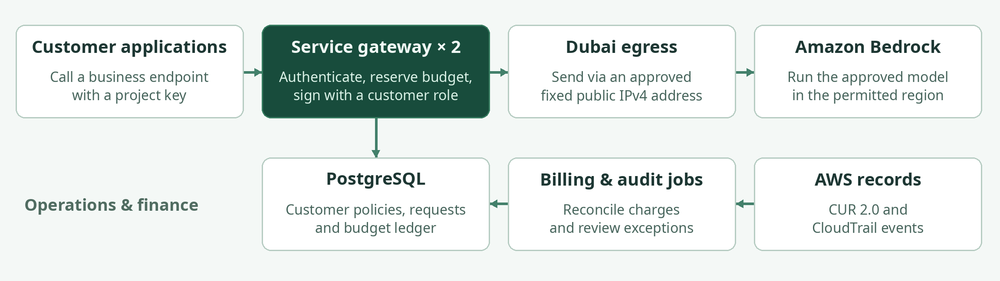
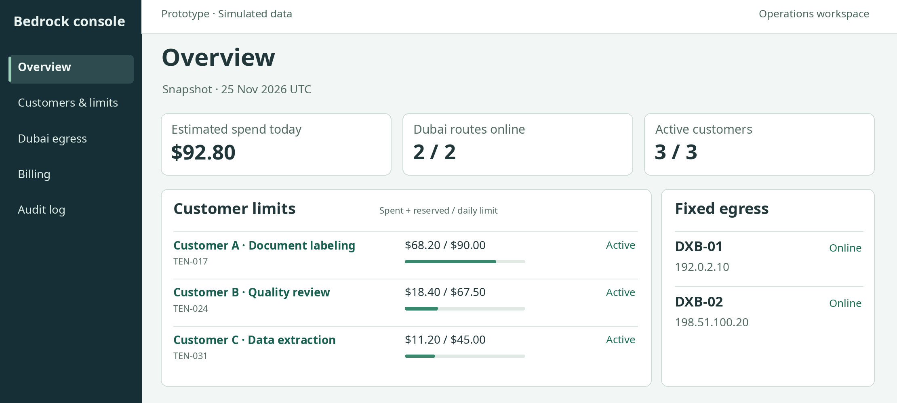
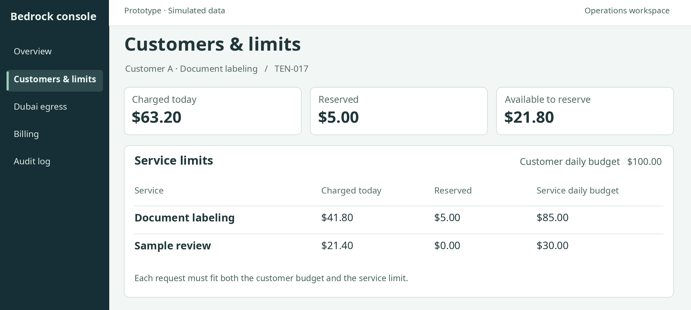

# Bedrock Multi-Customer Service Gateway

[中文手册](handbook.md) · [Propose a change](../CONTRIBUTING.md)

English engineering handbook · v1.1 · 2026-11-25

[Interactive prototype](https://bedrock-gateway-handbook.bright-bass-8857.chatgpt.site/en/prototype/) · [Online handbook](https://bedrock-gateway-handbook.bright-bass-8857.chatgpt.site/en/)

## Scope and release criteria

Implementation requirements, product design, architecture and operations · Design baseline v1.1

The service provider operates an independent gateway in front of Amazon Bedrock. Each customer keeps its production environment and calls the business API agreed in its contract. The gateway identifies the customer, checks its limits, sends the request through an approved Dubai public IP address and records usage per request. Bedrock runs the model. Finance uses AWS cost reports to reconcile each customer's bill.

### What the team must deliver

| Business requirement | Implementation | Evidence for release |
| --- | --- | --- |
| Fixed public egress | Approve N public IPv4 addresses in Dubai across the system. Customers may share an address or have a dedicated one. Assign each customer a primary address and an ordered subset of permitted backups. | Keep carrier evidence for each route. For a real inference request, the source IP recorded by AWS belongs to that customer's approved set. |
| Separate billing | Authorize each customer separately and meter each request. Reconcile by IAM identity or workspace tag, according to the inference API. | Attribute charges separately when two customers use the same model at the same time. Report unallocated charges separately. |
| Enforceable limits | Set daily and monthly spend and token limits, request rates and concurrency by customer and service. Reserve capacity and funds atomically before dispatch. | Send concurrent requests that compete for the last available balance. Only requests within the cap proceed, and retries do not produce a second charge. |
| Contain customer-specific incidents | Verify the actual end customer, use case and service geography. Include its registered enterprise profile on supported Claude requests. Apply suspensions at the scope specified by the provider. | Clients cannot impersonate another customer. Suspending one customer leaves other eligible customers operational. Account-wide action applies across the account. |

### First release

The first release covers fixed egress, one server-side role per customer, a usage ledger, customer suspension and daily cost reconciliation. The prototype uses two Dubai egress addresses, three fictional customers, USD and UTC billing periods. The business and engineering owners confirm the production address count, contracted prices, approved models and permitted data-processing regions during onboarding.

> **Provider restrictions.** Published policy gives no threshold at which multiple legitimate client IPs trigger suspension. Fixed egress supports network allowlisting and audit. The evidence for explaining an account's activity is its actual customer attribution, use cases and response to restrictions. AWS identity verification still leaves the model provider's regional and usage terms in force. Providers may act at account level. [1–3]

## Console and customer workflow

Operations works by customer. Finance works by billing period. The customer portal returns only the services and billing records that the signed-in customer's organization may access.

| Screen and owner | Information shown | Available actions |
| --- | --- | --- |
| Overview · on-call engineer | Service status, budget utilization, reservations, approved address count, available routes and requests awaiting review. | Open a customer. The prototype can simulate success, an unknown outcome after dispatch or a confirmed upstream restriction. |
| Customers & limits · operations | Company, services, status, primary and backup egress, allowed models, processing regions, role mapping, profile registration and limits. | Change a limit, suspend or resume a customer, or revoke a project key. Show the impact, previous and new values, operator and reason. |
| Dubai egress · network engineer | N approved public IPv4 addresses, location and allocation evidence, carrier, most recent AWS verification, assigned customers and failover history. | Version the address set and test failure and recovery. List affected customers before removing an address. |
| Billing · finance | Gateway estimate, AWS usage charges, contracted charge, variance, unallocated charges, report version and billing period. | Import a report version, review differences, export by customer and post adjustments after close. |
| Audit log · auditor | Request ID, tenant, project, model, actual egress, charge status and policy changes. | Search by customer and time. Authorize exports against a ticket, limit the access period and record the export. |
| My services · customer | Authorized services, settled spend, reserved funds, available balance, limits, billing period and settlement status. | Look up jobs and bills for the signed-in customer. The production API filters by organization and project on the server. Cross-tenant lookups return 404. |

### From onboarding to the first statement

Operations records the company, contracted purpose, actual service geography and data regions. It assigns project credentials, an IAM role, an enterprise profile and approved routes. Run two synthetic business requests and isolation tests before admitting a small volume of traffic. Finance then issues the customer statement for the month. Customers may call from different production IPs. At onboarding verify the company's location, controlling ownership and actual service regions, and record its support contact. Each project key is valid only for its contracted business service.

### Try the prototype

In **Overview**, select **Customer A · Document labeling**, enter a $2.50 reservation and choose **Send test request**. Submit the same idempotency key again. Open **Customers & limits** and **Audit log** to check the result. With a new key, simulate an unknown outcome after dispatch. Open **Billing** and record the simulated final usage evidence. Test **Import sample CUR** and **Export CSV**. In **Dubai egress**, disconnect DXB-01 and compare a customer pinned to its primary with one authorized to use a backup. Reset the demo to restore the original data.

> **Prototype scope.** All changes affect sample data in the current browser. The operator can switch to a customer view for demonstration. Production requires separate authenticated sessions. The prototype calculates in cents. The production ledger requires finer precision. Deployment acceptance covers real authentication, upstream calls, concurrency locks and AWS billing.

## How a request reaches Bedrock

The initial design uses two stateless gateway instances, a highly available PostgreSQL cluster with point-in-time recovery, and background jobs with separate permissions.

### Production request path

**1. Authenticate and authorize.** The customer calls its contracted endpoint with its own project credential. The gateway derives `tenant_id` and `service_id` from the authenticated credential and reads server-side configuration. The client cannot select `role_arn`, an enterprise profile, the upstream domain, the model region or an egress address.

**2. Reserve and sign.** Validate the business input, customer status, permitted use case and model. Lock the tenant and account budgets. After the reservation is durable, the workload obtains short-lived credentials for that customer's role, signs the request and dispatches it. Isolate cached credentials by tenant, role, policy version and expiry.

**3. Send and settle.** Select an approved Dubai route for the customer and use end-to-end TLS to the chosen public AWS endpoint. Record the upstream request ID when received. Final usage or explicit evidence of a non-billable outcome determines settlement. A separate reconciliation job reads AWS evidence and records any difference.

### Minimum API contract

| Operation | Contract and response |
| --- | --- |
| `POST /v1/jobs/label` | Requires a bearer project key, `Idempotency-Key` and agreed business fields such as `records` and `schema_version`. The server selects the model and maximum output. Return 200 for completed work, or 202 with an opaque `job_id` for work in flight or of unknown outcome. Validate the contractual schema, payload size and record count at ingress. |
| `GET /v1/jobs/{id}` | Return the current project's job status, result or pending-review status. Resubmitting the same key and request digest replays the recorded status. Reusing a key with different business parameters returns 409. |
| `GET /v1/usage` | Return the customer's authorized services, billing period, estimated cost or contract price, and status. Use 401 for invalid credentials, 403 for suspension, 429 for budget or rate limits, and 503 when approved egress, metering or the service is unavailable. |

Persist financial and policy decisions in database transactions. Publish asynchronous events through a transactional outbox and deduplicate by event ID. The idempotency key is unique within `tenant_id`, `service_id` and the client request key. During a network partition, only the side with access to the writable primary may admit requests. The side that loses access to authoritative budgets returns 503.

## Fixed public egress in Dubai

N is the total number of approved public IPv4 addresses the upstream service may observe. A workload may use only part of that set in normal operation. Customer count, IAM identity count and gateway replica count can each grow independently.

| Configuration | Behavior and acceptance |
| --- | --- |
| N = 1, fixed address | All assigned customers use the same address. Stop dispatch and return 503 when the route fails. If the carrier offers high availability with the same IP, verify that AWS records that same address after failover. |
| N ≥ 2, fixed primary | Multiple customers can share an address. For a customer that requires a single IP for its IAM identity, authorize only one `/32` and stop on primary failure. Allocate an exclusive address when the service agreement calls for it. |
| N ≥ 2, approved backups | Store an ordered subset of backup addresses for each customer. Switch only on confirmed network failure and only to a member of that subset. N remains the system-wide maximum. AWS will see the designated backup IP after the switch. |
| Address changes | Identify affected customers and issue a configuration version. Verify address allocation, routing and AWS policy conditions before releasing traffic. To maintain a hard limit of N throughout a change, stop dispatch, replace the address, then verify it. |

### Deployment and location evidence

Use a carrier or facility that can document its Dubai site and allocation of dedicated IPv4 addresses. For a two-address resilience design, check for shared failure domains across facilities, power, upstream links and carriers. An AWS UAE Region label alone does not establish that a particular address is in Dubai. At the baseline review date, AWS Health still listed a UAE Region disruption. Check current service health, the actual site and component availability before procurement. [9, 14]

Select routes by customer, using a separate network address translation (NAT) path or deterministic source NAT (SNAT) mapping per egress. Adding IPs to one NAT device alone does not establish a fixed address per role. Prefer independently verifiable Dubai facilities with distinct failure domains. Keep the primary database and its standby within the contractual data geography. Restrict default routes, forwarding and unapproved destinations. Use controlled IPv4 paths for public inference traffic. Verify behavior after restart and on backup routes. Check DNS, SDK IPv6 behavior, proxies and private endpoint settings. Disable unverified paths. PrivateLink has its own network conditions and requires separate controls. [8]

### Two forms of acceptance evidence

The network owner retains written site and carrier documentation, the autonomous system number (ASN) and IP allocation records. Geolocation databases can provide a cross-check. For every active egress, customer role and enabled endpoint, send a signed, low-cost inference request. Match its AWS request ID against CloudTrail and verify `sourceIPAddress`, caller identity and region. An external IP-check service is useful for troubleshooting.

> **Data geography.** The Dubai egress address establishes where the request leaves the network. Record the customer's actual location, storage regions for inputs and logs, the AWS invocation region and allowed inference destinations separately. For EU-only or similar terms, test the permitted regional routing and disable configurations that could process data outside the agreed geography. [2, 10]

## Three identifiers for each customer

Customers authenticate with credentials for the provider's business service. A server-side AWS identity governs authorization and billing attribution. The Anthropic enterprise profile identifies the actual end customer. The Bedrock inference profile selects a model or inference route.

| Identifier | Configuration and verification |
| --- | --- |
| AWS IAM role | Assign one role per customer with a static `tenant_id` tag. Split by service if projects also need separate AWS billing attribution. The application ledger always records the service. The role trusts only the gateway workload. Limit its inference actions, model resources, regions and approved public source IPs. |
| Anthropic User Profile | Register one profile per actual end-customer organization and store the mapping from `tenant_id` to `user_profile_id`. For a service delivered through the provider's own product, record `application` when that describes the actual relationship. If supplying a general-purpose API, check the `passthrough` requirements and the corresponding written authorization from the platform. [1, 3] |
| Bedrock inference profile | Select the model and permitted processing geography. Record the ID or ARN and the set of destination regions. The profile may route across regions. A dedicated application inference profile can also provide a cost dimension. Maintain it separately from the enterprise profile. [4, 10] |

### Enterprise profile compatibility

Register profiles in a Claude API or Claude Platform on AWS organization. Follow the provider's guidance on separate organizations for customer and internal traffic. Enforce one registration per company. If creation times out, look up the existing profile before submitting again. In the Verification Portal, confirm that the relevant AWS account shows `Linked` and check any required program eligibility. Enable only model, endpoint and region combinations that have been verified. [1]

For supported Bedrock Runtime models, send `user_profile_id` in the top-level JSON body of `InvokeModel` or `InvokeModelWithResponseStream`. The Converse API does not support that field. Check Mantle compatibility for each model. Before launch, read the enterprise ID and status from the registration system, then verify an actual request. Acceptance of a correctly formatted ID by Bedrock does not prove the ID belongs to the right company. Batch inference and unsupported models lack this attribution capability. Disable those combinations for customers who require it and confirm coverage with support. [1]

### Credentials and isolation

A Dubai workload outside AWS can obtain temporary credentials using an IAM Roles Anywhere workload certificate or trusted OIDC federation. Use workload roles inside AWS. Constrain the targets of `sts:AssumeRole`. Customers receive business API credentials and never receive AWS access keys. Use a separate operations role for model enablement and purchases. Exclude IAM administration, billing and unrestricted log access from the runtime role. For public inference explicitly deny source addresses outside the approved set. Run both permitted and denied tests. [8, 11]

Use SSO and MFA for the administration console. Separate operations, network, security, finance and audit roles. Enforce row-level authorization using `tenant_id` and `service_id`. Apply the same isolation to caches, object storage, job lookups and download links. Only the system may set identity tags. A request cannot override them.

## Budget reservations, concurrency and failures

Check the customer's monetary budget, tokens, request rate, concurrency and account-wide upstream quota on the same admission path, before dispatch to the model.

### Calculate the amount available to reserve

Set a total budget per customer and optional limits for individual services under the contract. Calculate the UTC daily and monthly windows independently. For each window, **available to reserve = budget × (1 − safety margin) − settled spend − outstanding reservations**. Apply the lowest remaining allowance across the applicable windows and the account. Round estimated costs up to integer microdollars. Round for display only after the ledger calculation.

> **Example.** With a $100 daily budget, a 10% margin, $63.20 settled, $5.00 reserved and sufficient monthly funds, a new request can reserve up to $21.80. If two concurrent requests each need $15, only one can proceed.

Freeze the price version at admission. Store rates for each model, region, service tier and cache time-to-live (TTL). Calculate an upper bound using the most expensive valid input and cache-write scenario and the maximum permitted output. Where available, use `CountTokens` with all applicable request fields. If a reliable upper bound, a required price or an additional tool charge is unknown, hold admission for hard-budget customers. Calculate AWS tokens-per-minute (TPM) quotas separately using the model's token burndown rules. [6]

### Request and reservation states

| State | Required action |
| --- | --- |
| Reserved, awaiting dispatch | Record the idempotency key, request digest, rate version, budget window and reservation in one transaction. Lock the account, tenant and service in a fixed order. Conditional updates and a unique key prevent overspend across instances. Enforce requests per minute (RPM) and TPM with shared windows or token buckets. Queue by customer with a maximum length, timeout and account-wide cap. |
| In flight | Persist “possibly sent” before dispatch. Give each worker a unique claim token. After a crash, interrupted client stream or timeout, mark the outcome unknown unless evidence shows the request was never sent. Disable automatic redispatch for uncertain requests. |
| Known result | Settle once when final usage and the AWS request ID are available. Release the unused part of the reservation. Release all funds on explicit evidence of a non-billable outcome. For a stream, settle on the final usage event. Keep an unknown request's reservation separate. |
| Manual review | Keep the funds reserved until matching final evidence arrives. An aggregated Cost and Usage Report (CUR) cannot establish the outcome of an individual call. Across midnight, restarts and client replays, keep the original budget window. Manual adjustments require evidence, approval and an immutable adjustment record. |

Use a keyed HMAC of the request to detect idempotency conflicts. Give budget, RPM, TPM, concurrency and upstream throttling distinct error codes under HTTP 429. Supply an appropriate `Retry-After` for temporary rate limiting. When a client stops reading, attempt upstream cancellation and use available evidence to determine whether the request was billed.

## Daily customer usage and monthly AWS reconciliation

Operations needs real-time totals for settled spend, outstanding reservations and available funds. Finance reconciles at the granularity AWS provides. The customer statement uses the price and billing units agreed in the contract.

### AWS Billing settings

For Bedrock Runtime `InvokeModel`, attribute usage through the customer's IAM role. In **Billing and Cost Management → Cost Allocation Tags**, activate `iamPrincipal/tenant_id`. In Cost Explorer, filter on Amazon Bedrock and group by that tag. For Anthropic Messages on Bedrock Mantle, use the customer workspace's cost allocation tag. See **Two-customer pilot** for that setup. [4, 5]

In **Billing and Cost Management → Data Exports**, configure CUR 2.0 and enable **Include caller identity (IAM principal) allocation data**. Verify `line_item_iam_principal`, usage type, time, unit and charge in the export. Native Bedrock IAM attribution aggregates by caller identity, usage type and day. The gateway ledger supplies the per-request and hourly views. [4, 5]

### Billing records and cost definitions

| Record | Minimum fields and handling |
| --- | --- |
| Request ledger | Record `tenant_id`, `service_id`, `job_id`, idempotency digest, `attempt_id`, AWS `requestId`, model, region, tier, UTC time, egress, state and price version. Keep uncached input, output, cache reads and cache writes in separate fields, splitting writes by TTL. Check SDK counting conventions to avoid double counting. Store the pricing unit per thousand or million tokens with the price version. |
| AWS cost ledger | Reconcile by account, customer attribution dimension (role or workspace tag), UTC day, usage type, region and tier. Maintain effective dates for identity mappings and tags. AWS aggregates CUR attribution by day. The gateway retains the individual calls. |
| Customer statement | First compare model usage charges in the same currency, using unblended cost by default. Show discounts, credits, taxes, networking and service fees separately. Agree a consistent basis for net cost. Export service subtotals, contract price, reconciliation status and period detail. |
| Variances and adjustments | Mark missing tags, shared costs and charges without supported identity attribution as unallocated. Import each version of the export manifest idempotently and recalculate late-arriving data. Preserve closed periods through debit or credit adjustments. Do not divide unexplained charges among customers. |

### Worked example

The gateway estimates $90.50 across three customers. AWS reports $92.00 in attributable charges plus $0.80 unallocated, for a $92.80 usage subtotal. Customer B has a $1.50 variance. Finance checks rates, caching, cross-region charges and late-arriving items. In the demo contract, Customer A owes $82.40, comprising $62.40 in usage and a $20 fixed service fee. Customer B's amount remains pending until review.

> **Access to billing data.** Keep CUR files in encrypted S3. Give the finance job read-only access to its designated prefix and audit reads. The portal reads filtered customer settlement records. Customer projects and gateway runtime roles have no access to the payer account's bills.

## Alerts, suspension and recovery

On-call staff verify the customer's eligibility, whether dispatch was authorized, the actual source address and whether charges reconcile. The thresholds and timings below are initial design targets.

| Signal and owner | Response and evidence for recovery |
| --- | --- |
| Unknown source IP or both routes down · network | Stop the affected route or customer immediately. Check the AWS request ID, actual source IP, SNAT and route version. Return 503 while dispatch is stopped. Resume only after an approved route recovers and a low-cost probe succeeds. |
| 403 or provider notice · security | Check IAM, model access, regional restrictions and the official notice. For a confirmed customer restriction, freeze that customer and the stated scope. Enforce an account or organization restriction across its stated scope. Keep incident IDs, request IDs and policy versions. Contact AWS Support. Resume after formal clearance and human verification. [13] |
| 429, 5xx or timeout · on-call engineer | Check account-level model quotas and tenant concurrency. Back off or queue throttled work with a maximum wait. Do not automatically retry an inference accepted by the upstream or of unknown outcome. Keep the same IP, identity and endpoint when handling platform restrictions or throttling. |
| Anomalous usage · operations and finance | Alert at 80% of the usable budget and block at the limit. Notify on-call staff about sudden growth in per-request usage or unknown reservations older than 15 minutes. Send a daily variance to manual review when it exceeds the greater of $1 and 2% of comparable daily charges. Always list unallocated charges. |
| Credential or database incident · platform | Disable the affected project, revoke exposed credentials and address the credential cache. Reject new requests while the database is locked or the writable primary is unavailable. Verify reservations, idempotency state and the outbox before reopening. |

### Monitoring and audit

Report by customer, model and region. Track request count, reasons for admission or rejection, time to first token, P95 latency, concurrency, reservation age, AWS errors and admission latency. For Runtime streams, use `parentRequestId` to correlate invocation and completion events and deduplicate by the original invocation. When enabling Mantle, configure and budget for its billable CloudTrail data events separately. [7, 15]

Default logs contain metering and diagnostic metadata only. Exclude project keys, credentials and raw request or response bodies. If AWS model invocation content logging is needed, agree its authorization, region and retention period separately. Cover application caches, backups and deletion in the contract. Subscribe to enterprise profile status changes or poll regularly. Authenticate incoming notices and define when a stale status must stop dispatch. [1, 12]

### Operating schedule

Daily, check route probes, outstanding reservations, AWS Health, customer status, billing exports and the notifications mailbox. Weekly, sample source-IP records and denied cross-tenant lookups. Monthly, close the books and review use cases and permissions. Quarterly, drill failover, certificate rotation and backup recovery. The suggested ledger recovery point objective (RPO) is at most 5 minutes, with a recovery time objective (RTO) of at most 60 minutes. Keep potentially dispatched requests from the recovery interval on hold until verified.

## Production acceptance and IAM migration

Engineering signs off against the following tests. The prototype and logic tests cover sample scenarios. Verify the carrier links, AWS permissions, actual charges and high concurrency in the deployment environment.

| Acceptance area | Test and pass criteria |
| --- | --- |
| Network and fixed addresses | Test every customer, endpoint, primary and backup route. Retain carrier evidence, the AWS request ID and `sourceIPAddress`. Requests from unapproved addresses are denied. With both routes down, return 503 and stop dispatch. A restricted customer cannot switch routes. |
| Identity and privacy | Customer A cannot impersonate B's tenant, role or profile, read B's bill or use its download link. Denials must not reveal that B's resources exist. Read the official enterprise profiles, compare the registered mapping and confirm clients cannot override it. Verify use case, service geography and contractual routing. |
| Limits, idempotency and stream interruption | With $21.80 available across two gateway instances, submit two simultaneous $15 reservations. Exactly one may proceed. Simulate retries, the same key with different inputs, crashes, interrupted streams, duplicate events and a UTC date change. Verify a single dispatch and charge and no release of funds without evidence. |
| Attribution, revisions and billing | Send identifiable, low-cost requests under two actual customer roles. Verify attribution when the CUR is available. Re-importing the same report leaves balances unchanged. Importing a revision produces traceable adjustments. Hold shared or unexplained charges for review and verify isolation of each customer's records. |
| Performance, recovery and observability | With a simulated upstream, run 20 requests per second for 15 minutes, then 50 requests per second for 60 seconds. Use representative request lengths, cache behavior and streaming traffic. Target gateway-added P95 latency of ≤100 ms, excluding upstream and external network waits. At 50 requests per second and an average of 3 seconds in flight, allow roughly 150 concurrent slots. Low-cost real-model spot checks incur separate charges. |
| Suspension, recovery and release | Drill customer-specific and account-wide suspension, route failure, database recovery and safe rollback. Provide monitoring records, on-call contacts, attribution mappings, configuration versions, test results and records of how exceptions were handled. |

### Move from existing IAM identities

Inventory the current IAM users, key holders, workloads and historical billing dimensions. Record each old identity, its tenant, the replacement role and the effective time. For a small volume from a test customer, record charges in both ledgers but dispatch each request only once. Join the old and new billing records at the cutover time.

Move customers to business API credentials in batches. During the approved window, an administrator restricts inference permissions on the old identities. Confirm in CloudTrail that direct calls have stopped before disabling old keys. Any old credential that still allows direct calls leaves a path outside the gateway's egress and hard budget controls. Roll back only to a verified gateway version, retaining ledger entries, suspension decisions and address restrictions.

> **Release sign-off.** Product confirms service and contract scope. Network confirms Dubai routes and N. Security confirms roles and enterprise profiles. Finance confirms both customers' CUR records. The on-call owner confirms the failure drills. Increase traffic customer by customer after the pilot passes.

## Two-customer pilot

Use two independent customer identities to invoke the same model on the same UTC date. Rehearse concurrency and route failure in a test environment, then run approved low-cost real requests to check the AWS records. The deployment team still needs to execute and sign off these items.

### Choose cost attribution for the actual API

**Bedrock Runtime · InvokeModel.** Give Customers A and B separate IAM roles, each tagged with its own `tenant_id`. Activate the IAM cost allocation tag and enable caller identity allocation data in CUR 2.0. Reconcile the two customers' charges independently.

**Bedrock Mantle · Anthropic Messages.** Assign Customers A and B separate Workspaces and activate the customer cost allocation tag on each. The gateway supplies the correct `anthropic-workspace-id` header. Hold default-workspace or untagged charges for review.

[AWS cost attribution and supported APIs](https://docs.aws.amazon.com/bedrock/latest/userguide/cost-management.html) · [Workspace header and attribution rules](https://docs.aws.amazon.com/bedrock/latest/userguide/workspaces.html)

### Evidence from the same pilot

| Owner | Test and pass criteria |
| --- | --- |
| Network engineer | A and B send requests from different customer networks. Match the actual source IP to each AWS request ID. Each IP must belong to that customer's approved Dubai set. Disconnect the primary route for a customer with a single approved address and verify that dispatch stops for that customer. |
| Backend engineer | Give A $10 of reservable balance in the test ledger. Submit two simultaneous requests that each need $7. Only one proceeds. A retry with the same key produces a single charge. Suspend A and confirm that B can still use the service. |
| Finance and operations | A and B each send identifiable low-cost requests. Once the CUR arrives, reconcile it with the gateway ledger by UTC day and usage type. Re-import it without duplication. Downloading a bill under A's customer identity returns only A's records. |
| Business owner | Using the same approved samples, compare business outcomes, response times and cost per item before and after cutover. Send a small volume to one low-risk service first. Increase traffic only after meeting the agreed thresholds. |

> **Sign-off record.** In an internal ticket, record the environment, API and model, A/B identity mappings, request IDs, source IPs, CUR version, variance and signatories. Use “Pending finance review” until the bill is ready to issue. Pause the pilot if charges cross customers, traffic uses unapproved egress or an over-budget request is admitted.

## Official references and pilot inputs

The design baseline records a review date of 2026-11-25. Once the model, AWS account and deployment location are selected, the engineering owner rechecks the compatibility matrix, service health and the contract on the day traffic is increased.

**01** [Anthropic · User profiles for end-customer attribution](https://platform.claude.com/docs/en/manage-claude/user-profiles) · Enterprise profiles, Bedrock compatibility and organization-level restrictions.

**02** [Anthropic · Supported Regions Policy](https://www.anthropic.com/legal/supported-regions) · Actual service geography and company ownership or control.

**03** [AWS · Third-party model terms for Anthropic on Amazon Bedrock](https://aws.amazon.com/legal/bedrock/third-party-models/) · Use in a customer-facing product and the scope of authorization.

**04** [AWS · IAM principal attribution for Amazon Bedrock](https://docs.aws.amazon.com/bedrock/latest/userguide/cost-mgmt-iam-principal-tracking.html) · Roles, cost allocation tags and CUR 2.0.

**05** [AWS · Understanding your Bedrock CUR data](https://docs.aws.amazon.com/bedrock/latest/userguide/cost-mgmt-understanding-cur-data.html) · AWS dimensions used in reconciliation.

**06** [AWS · Calculate token burndown for quotas](https://docs.aws.amazon.com/bedrock/latest/userguide/quotas-token-burndown.html) · Account-level token quotas and model-specific rules.

**07** [AWS · Log Bedrock API calls using CloudTrail](https://docs.aws.amazon.com/bedrock/latest/userguide/logging-using-cloudtrail.html) · Inference requests, stream completion events and source IPs.

**08** [AWS · IAM global condition context keys](https://docs.aws.amazon.com/IAM/latest/UserGuide/reference_policies_condition-keys.html) · Public-source-IP and VPC endpoint conditions.

**09** [AWS Health · Service health](https://health.aws.amazon.com/health/status) · UAE Region events to review before launch.

**10** [AWS · Cross-Region inference](https://docs.aws.amazon.com/bedrock/latest/userguide/cross-region-inference.html) · Possible inference destination regions.

**11** [AWS · IAM Roles Anywhere](https://docs.aws.amazon.com/rolesanywhere/latest/userguide/introduction.html) · Short-lived credentials for workloads outside AWS.

**12** [AWS · Model invocation logging](https://docs.aws.amazon.com/bedrock/latest/userguide/model-invocation-logging.html) · Request and response content and access to logs.

**13** [AWS · Abuse detection](https://docs.aws.amazon.com/bedrock/latest/userguide/abuse-detection.html) · Account notices and incident response.

**14** [MaxMind · Geolocation accuracy](https://support.maxmind.com/knowledge-base/articles/maxmind-geolocation-accuracy) · Limits of city-level IP geolocation.

**15** [AWS · Monitor bedrock-mantle API calls using CloudTrail](https://docs.aws.amazon.com/bedrock/latest/userguide/logging-cloudtrail-mantle.html) · Mantle inference data event configuration.

### One onboarding record per pilot customer

Record the company and contracted services, actual service countries, place of incorporation or establishment, and permitted data-processing regions. Include daily and monthly budgets and service sublimits, RPM, TPM, concurrency and maximum input/output per request. List approved models, endpoints and regions, primary and backup egress, the IAM role, actual enterprise profile, business contact and emergency contact.

### Platform-wide decisions

Confirm N, the physical locations and providers of the egress links, account-level model quotas, rates, tax treatment, cost alert recipients, and owners for approval and rollback. The pilot examples use USD, UTC and a 10% safety margin. Each contract may specify different settings.

## Operations and customer budget screens

Open the interactive prototype in your browser. The following examples show the overview and service budget screens.

### Operations overview

### Customer A's two services

Customer A has $21.80 left to reserve across its services. Its sample-review service has a $30 daily budget. Applying the 10% margin and subtracting $21.40 already used leaves $5.60 available for that service. Other services can continue to use their own remaining balances.
