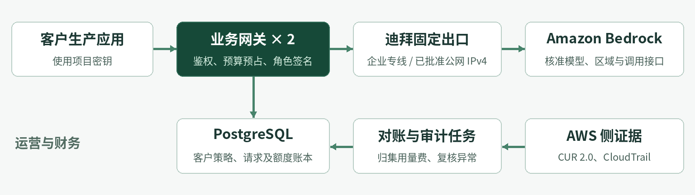
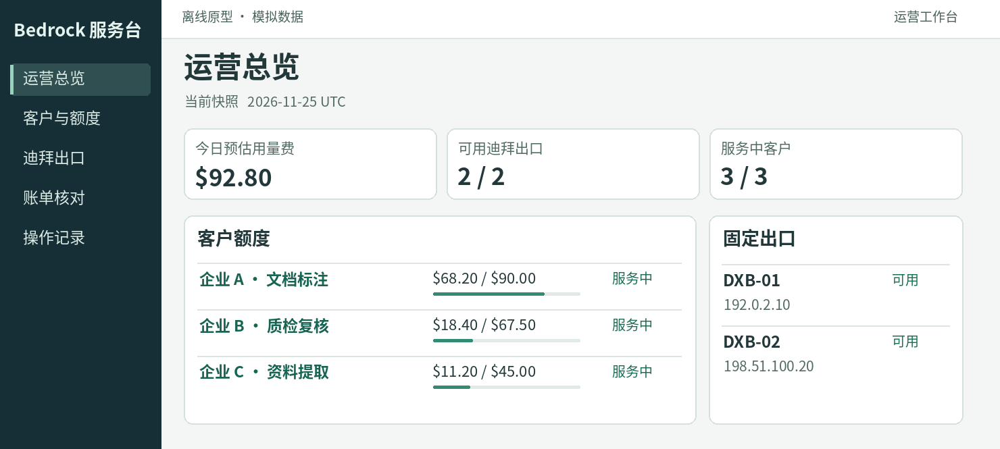
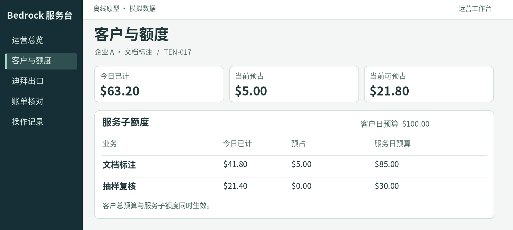

# Bedrock 多客户服务网关

中文工程手册 · v1.0 · 2026-11-25

[在线原型](https://bedrock-gateway-handbook.bright-bass-8857.chatgpt.site/prototype/) · [公开工程手册](https://bedrock-gateway-handbook.bright-bass-8857.chatgpt.site/)

## 客户交付要求

实施需求、产品原型、架构与运维手册　｜　设计基线 v1.0

客户继续从各自的生产环境访问你的业务。由你的服务端识别客户、执行约定业务，再通过指定数量的迪拜出口调用 Bedrock。每笔请求记录归属，按客户限额，月底用 AWS 成本数据复核。

### 交付与上线标准

| 业务目标 | 技术团队交付 | 放行证据 |
| --- | --- | --- |
| 固定出口 | 全系统批准 N 个迪拜公网 IPv4。客户可共用或独占，逐客户指定主地址及备用子集。 | 每条线路有运营商证明。真实推理事件的 AWS 源 IP 属于该客户批准集合。 |
| 独立分账 | 一客户一服务端角色，应用侧记录逐笔用量。独立财务任务按 IAM 身份对账。 | 两个客户同模型、同时间调用仍能分别归属。无法归属的费用单独列出。 |
| 可控用量 | 按客户及服务设日/月金额、频率、Token 与并发上限。发送前原子预占。 | 用并发请求争用最后一笔余额，批准数不超额。重试不重复扣费。 |
| 降低连带影响 | 核实实际客户、用途和地域。支持的 Claude 请求携带真实企业档案，提供分范围停用。 | 客户身份无法伪造。单客户暂停不影响其他正常客户，账户级处置按原范围执行。 |

### 第一版的选择

优先交付固定出口、逐客户角色、用量账本、可暂停的客户配置和日对账。原型以两个迪拜出口、三个虚构客户、美元和 UTC 账期演示。正式数量、合同费率、允许模型及数据处理地区由业务和技术在开户表确认。

> 风险判断　公开规则没有给出“多个正常来源 IP 会触发封禁”的阈值。统一出口可供网络白名单和审计使用。实际企业归属、客户用途及限制后的正确处置，才能支持向平台说明业务。AWS 身份核验通过仍需遵守模型服务地域和使用条款，且平台保留账户级处置权。［1–3］

## 后台页面与客户旅程

运营按客户工作，财务按账期工作。客户自助页面只返回本企业已获授权的服务和账单。

| 页面／使用者 | 页面上要看见什么 | 可操作事项 |
| --- | --- | --- |
| 运营总览／值班 | 服务状态、预算使用率、预占、批准出口数、可用线路、待核请求。 | 进入客户详情。原型可模拟成功、结果未知或已确认的上游限制。 |
| 客户与额度／运营 | 企业及服务、状态、主备出口、允许模型、计算区域、角色映射、档案登记状态和配额。 | 改额、暂停、恢复、撤销项目密钥。变更展示影响、旧值、新值、操作者及原因。 |
| 迪拜出口／网络 | 批准的 N 个公网 IPv4、归属证据、运营商、最近 AWS 验证、绑定客户与切换记录。 | 维护版本化地址集，测试断线和恢复。删除前列出受影响客户。 |
| 账单核对／财务 | 网关预估、AWS 用量费、已签合同金额、差额、未分配费用、报表版本与账期。 | 导入新版本、看差异、按客户导出、关账后登记调账。 |
| 操作记录／审计 | 请求号、租户、项目、模型、实际出口、费用状态及策略变更。 | 按客户及时间检索。按工单授权、限时导出、留痕。 |
| 我的服务／客户 | 仅本企业授权服务的已用额、预占额、余额、限额、账期及结算状态。 | 查询任务和本方账单。生产 API 服务端过滤企业及项目，跨租户查询返回 404。 |

### 开户到出账

运营登记企业、合同用途、实际服务地与数据地区 → 分配项目凭证、角色、企业档案及主备线路 → 做两笔合成业务和隔离测试 → 小流量上线 → 财务出客户月报。客户生产 IP 可以不同。开户时核实企业所在地、控制权和实际服务区域，并保存支持联系人。项目密钥只适用于约定业务。

### 原型演示路径

在总览用企业 A 提交 $2.50，再用同一幂等键提交一次。查看客户额度及记录。给新键选择“发送后结果未知”，到账单页补录模拟最终凭证。到出口页断开 DXB-01，对比固定主出口客户及允许备用的客户。可重置恢复原样。

> 原型边界　浏览器里的操作只改本机示例。为方便演示，运营可切换客户视角。正式系统须分别登录。原型实现的计算采用美分，生产账本须以更细精度保存。真实认证、上游、并发锁及 AWS 发票由部署验收覆盖。

## 一次请求如何到达 Bedrock

初版使用两个无状态网关实例，一个有高可用和时间点恢复能力的 PostgreSQL 集群，以及独立权限的后台任务。

### 线上请求

**1　接入与授权** 客户用自家项目凭证调用约定接口。网关从已认证凭证解析 tenant_id 与 service_id，查服务端配置。禁止客户端指定 role_arn、企业档案、上游域名、模型区域或出口 IP。

**2　准入与签名** 验证业务输入、客户状态、允许的用例与模型。锁定租户和账户额度，在持久化预占后，由工作负载取得该客户角色的短期凭证，签名并发送。凭证缓存按租户、角色、策略版本、到期时间隔离。

**3　出站与回写** 网关选择该客户批准的迪拜线路，端到端 TLS 到选定 AWS 公网端点。收到上游请求号后记录。最终用量或明确无计费结果驱动结算。异步对账读取 AWS 证据并登记差异。

### 最小接口约定

| 调用 | 契约与返回 |
| --- | --- |
| POST /v1/jobs/label | Bearer 项目密钥、Idempotency-Key、约定业务字段（如 records、schema_version）。服务端定模型和输出上限。完成返回 200。在途或结果未知返回 202 及不透明 job_id。入口按合同做 schema 校验、请求体大小与条数上限。 |
| GET /v1/jobs/{id} | 返回本项目的状态、结果或待核状态。相同键且请求摘要相同回放已有状态。相同键但业务参数不同返回 409。 |
| GET /v1/usage | 返回本客户有权查看的服务、账期、预计成本或合同价与状态。401 凭证无效。403 已停用。429 额度/速率。503 无批准线路、计量不可用或服务不可用。 |

资金与策略在数据库事务中落地，异步事件使用事务发件箱并以事件 ID 去重。幂等唯一键作用域为 tenant_id、service_id 和客户端请求键。两地网络分区时只允许数据库主写侧放行，失去额度真值的一侧返回 503。

## 固定迪拜公网出口

N 是批准的、可被上游观察到的公网 IPv4 地址总数。业务平时可能只使用其中部分地址。客户数、IAM 数、网关副本数均可独立扩展。

| 配置 | 行为与验收 |
| --- | --- |
| N＝1，客户固定地址 | 所有指定客户使用同一地址。单线路失效时停发并返回 503。若运营商支持同 IP 高可用，需实测切换后 AWS 仍记录相同 IP。 |
| N≥2，固定主地址 | 可让多个客户映射同一地址。希望每个 IAM 永远同 IP 的客户只批准一个 /32，主线故障即停发。独占地址属于单独的分配策略。 |
| N≥2，允许主备 | 明确记录每个客户备用 IP 的有序子集。仅在已确认的网络故障时切到其中一个。N 是总上限。切换后客户源地址会变为指定备用地址。 |
| 地址变更 | 先检查受影响客户，签发配置版本。验证归属、网络路由和 AWS 条件策略一致后再放量。硬性 N 约束下按停发、替换、验证的顺序完成。 |

### 实际部署与地域证明

选能出具迪拜机房位置和专用 IPv4 分配证明的运营商或机房。两个地址若需容灾，核对机房、电源、上联及运营商故障域。AWS UAE 区域标签本身不足以证明一条地址位于迪拜。AWS Health 在审阅日仍列 UAE 区域中断事件，采购前核对服务健康、目标机房和组件可用性。［9、14］

网关按客户选路，每个出口使用独立 NAT 路径或固定 SNAT 映射。仅给同一个 NAT 增挂多个地址无法证明逐角色固定。优先在可核验的迪拜托管环境分故障域部署，数据库主备遵守合同地域。限制工作负载的默认路由、转发及非批准目的地。公网推理仅启用受控 IPv4 路径。验证重启、备用路由、DNS 和 SDK 的 IPv6、代理及私有端点设置。未经验证的入口停用。PrivateLink 的网络条件与公网源地址分别设计。［8］

### 验收用两套证据

网络负责人保存机房/运营商书面证明、ASN 与 IP 归属记录。地理数据库可交叉参考。每个实际出口、客户角色和启用端点都发签名的小额测试推理，按 AWS 请求号核对 CloudTrail 的 sourceIPAddress、身份和区域。外网查 IP 的结果只用来排查。

> 数据地区　迪拜出口只描述发包地点。另行列明客户实际所在地、输入/日志保存地、模型调用区域和允许的推理目的地。签有 EU-only 等限制时，在允许范围实测区域路由，禁用可能将处理转出合同地域的配置。［2、10］

## 每个客户的三个标识

客户使用你自己的服务凭证。AWS 身份用于授权和分账，Anthropic 企业档案用于标明实际终端客户，Bedrock 推理配置负责选择模型或路由。

| 标识 | 设置与验证 |
| --- | --- |
| AWS IAM 角色 | 一客户一角色，静态标签 tenant_id。不同项目需要 AWS 原生独立账目时再按服务拆角色。应用总账始终按服务记。角色只信任网关工作负载。角色策略限定推理动作、模型资源、区域和批准公网源 IP。 |
| Anthropic User Profile | 按真实终端企业登记一份，存 tenant_id → user_profile_id。承接自有产品业务，按实际关系填写 application。涉及通用 API 转供时须核对 passthrough 及平台相应书面授权。［1、3］ |
| Bedrock inference profile | 选定模型及允许的处理地域。记录 ID/ARN 和目标区域集。配置可能涉及跨区域路由。独立应用推理配置可作为成本维度，和企业档案分别维护。［4、10］ |

### 企业档案的兼容性核对

在 Claude API 或 Claude Platform on AWS 的组织中登记，客户流量与内部用量按官方指引分组织。管理端按企业唯一建档，遇创建超时先核实再补建。在 Verification Portal 检查相关 AWS 账户的关联状态（Linked），另查所需项目资格。仅开放经过验证的模型、端点、区域组合。［1］

在支持的 Bedrock Runtime 模型上，通过 InvokeModel 或 InvokeModelWithResponseStream 的顶层 JSON 传 user_profile_id。Converse 不支持。按模型单独确认 Mantle 兼容性。投产前从登记端读回企业 ID 及状态，再验证实际调用。Bedrock 接受格式正确的 ID 并不能证明归属正确。批量推理及未支持的模型缺少此归属能力。需要归属的客户停用这些组合，并向支持团队确认。［1］

### 凭证与隔离

云外迪拜节点可用 IAM Roles Anywhere 的工作负载证书或受信任 OIDC 获得临时身份，云内使用工作负载角色。限制 sts:AssumeRole 的目标，不给客户 AWS AK/SK。模型开通、采购由独立运维角色负责。运行角色不授予 IAM 管理、Billing 或全量日志读取。策略对公网推理显式拒绝批准集合之外的源地址，做正反向实测。［8、11］

管理端采用 SSO＋MFA，分运营、网络、安全、财务、审计角色。业务表使用 tenant_id 与 service_id、行级授权。缓存、对象存储、任务读取与下载链接同样隔离。仅系统可设置身份标签，禁止请求覆盖。

## 预占、并发与失败后的资金状态

用量控制必须发生在请求送到模型之前。客户金额、Token、频率、并发和账户上游配额在同一条准入路径检查。

### 预算计算

按合同设置客户总额及可选服务子限额，UTC 日/月两个窗口各自计算。可预占 = 窗口预算 ×（1 − 安全余量）− 窗口已结算 − 窗口未结预占。选各窗口及账户可用额中的最小值。以整数微美元向上预估费用。显示时再四舍五入。

> 计算例　日预算 $100，安全余量 10%，今日已计 $63.20，在途预占 $5.00，月余额充足。新请求最多可预占 $21.80。两个并发请求各需 $15 时只能放行一个。

冻结价格版本。为同一模型、区域、服务等级和缓存 TTL 设单价。按输入及可能缓存写入的最贵合法情形和允许的最大输出估算上界。可用 CountTokens 时先按适用计数，覆盖实际请求字段。无可信上界、附加工具费用未知或无价格时，硬预算客户停止准入。AWS TPM 按型号的 token burndown 另算。［6］

### 请求与预占状态

| 状态 | 必须执行的动作 |
| --- | --- |
| 待发送／已预占 | 在单个事务内记录幂等键、请求摘要、费率版本、预算窗口和预占。按固定顺序锁账户、租户、服务，条件更新及唯一键保证两个网关不会超发。RPM/TPM 用共享时间窗或令牌桶，按客户排队并设队长、超时和账户总上限。 |
| 生效／已发送 | 发送前先落“可能已发送”的持久状态。worker 认领采用唯一令牌。进程崩溃、客户端断流或超时后，除非能证明未发送，转“结果未知”，禁自动重发。 |
| 结果明确 | 拿到最终 usage 和 AWS 请求号后仅结算一次，释放差额。明确未发生计费则释放预占。流式请求在最终用量事件结算。未知请求的额度独立保留。 |
| 人工核对 | 保留预占，等待可关联的最终计量。账期汇总 CUR 不能单独证明某一请求。跨日、重启及客户端重放沿用原窗口。人工核销要证据、审批和不可覆盖的调整记录。 |

用请求指纹（密钥 HMAC）识别幂等冲突。将 HTTP 429 的额度、RPM、TPM、并发和上游限流分别编码。瞬时频率超限才给合适 Retry-After。客户端停止读取时尝试取消上游，按证据确认是否计费。

## 客户日账与 AWS 月度对账

运营需实时看“已用、预占、剩余”。财务按 AWS 可取得的汇总粒度核对。客户最终应付按合同的价格和计费单位生成。

### 账单设置与查看位置

付款账户或独立账户在 Billing and Cost Management → Cost Allocation Tags 中激活 iamPrincipal/tenant_id。Cost Explorer 筛选 Amazon Bedrock，按已激活的该标签分组。角色 ARN 可用于 CUR 映射。先验证真实字段和两个客户分别出数。［4、5］

在 Billing and Cost Management → Data Exports 配置 CUR 2.0，勾选 Include caller identity (IAM principal) allocation data。验证导出含 line_item_iam_principal、用量类型、时间、单位和费额。AWS 的 Bedrock IAM 原生归因文档给到按身份、用量类型及日的粒度，运营逐笔及小时视图由网关账本产生。［4、5］

### 账本与口径

| 记录 | 最少字段与处理 |
| --- | --- |
| 逐笔／请求账 | tenant_id、service_id、job_id、幂等摘要、attempt_id、AWS requestId、模型/区域/服务等级、UTC 时间、出口、状态、价格版本。输入非缓存、输出、缓存读和各 TTL 缓存写分栏，避免 SDK 口径重复。每千／百万 Token 单位写入费率版本。 |
| AWS／归集账 | 按账户、规范化 IAM 身份、UTC 日、用量类型、计费区域和等级核对。将已知角色的 STS 会话 ARN 映射到角色，核实标签与历史生效区间。CUR 无请求号，不作逐笔匹配。 |
| 客户／结算单 | 先比较相同币种的模型用量费（默认 unblended cost）。折扣、信用、税、网费和服务费单列，净成本采用另行确认的统一口径。各服务小计、合同价、核对状态及账期明细可导出。 |
| 差异／调整账 | 未标记、共享或不支持身份归因的项目进入“未分配”。导出按 manifest 版本幂等导入，迟到数据重算。已开票账期以补差/贷项保留历史，不按比例摊给客户。 |

### 样例核对

三客户网关预估 $90.50。AWS 可归属 $92.00，另有 $0.80 未归属，AWS 用量小计 $92.80。企业 B 差异 $1.50。财务复核价格、缓存、跨区或迟到项。在演示合同中，企业 A 的 $62.40 用量费加 $20 固定业务服务费，应付 $82.40。企业 B 复核前应付金额标为待定。

> 保管权限　CUR 文件放加密 S3，限定财务任务只读指定前缀并审计其读取。客户门户从已过滤的客户结算表读取。普通客户项目与网关运行角色都不读取付款账户账单。

## 告警、停发与恢复

值班同时看四个维度：客户是否获准使用、请求是否获准发送、实际上从何处发出、钱能否对上。以下时间和阈值为初版建议。

| 信号／负责人 | 处理动作和恢复证据 |
| --- | --- |
| 未知源 IP 或双线中断／网络 | 立即停受影响线路或客户。核对 AWS 请求号、实际源地址、SNAT 和路由版本。仅在批准线路恢复且小额探针通过后放行，停发期间返回 503。 |
| 403 或平台通知／安全 | 先核对 IAM、模型授权、地理限制及正式通知。确认客户限制则冻结该客户及受限范围。账户/组织级则按原范围停。保留事件号、请求号和政策版本，向 AWS Support 回报。［13］凭正式解除及人工核验恢复。 |
| 429、5xx、超时／值班 | 检查账户模型配额和各租户并发。对限流退避、排队并设等待上限。已被上游接收或状态未知的推理不自动重试。不因平台限制、限流而变更 IP、身份或端点。 |
| 用量异常／运营、财务 | 预算可用上限达到 80% 提醒。到上限拦截。逐笔异常增速、未知预占超过 15 分钟通知值班。日对账差异超过 max($1, 当日同口径费用的 2%) 进入人工复核。未归属费用始终列项。 |
| 凭证或数据库事故／平台 | 停用泄露项目、吊销凭证并处理缓存。DB 封锁或丧失主写时拒绝新请求。恢复后先核对预占、幂等状态与发件箱，再开放。 |

### 监控与审计

按客户、模型和区域上报请求数、放行/拒绝原因、首 Token 耗时、P95 延迟、并发、预占年龄、AWS 错误和准入耗时。Runtime 流式的调用事件与完成事件用 parentRequestId 串联，按原始调用去重。启用 Mantle 时另配付费数据事件和预算。［7、15］

日志默认只存计量与故障元数据，项目密钥、凭证、原始请求/响应正文不写日志。AWS 模型调用内容日志若需开启，单独约定授权、地区和期限。合同覆盖应用缓存、备份与删除。订阅企业档案状态变更或定期轮询，核验通知真实性并设状态过期停发规则。［1、12］

### 值班周期

每日看线路探针、未结预占、AWS Health、客户状态、账单导出和通知邮箱。每周抽查源 IP 和跨租户拒绝日志。每月结账、核作用途和权限。每季度做故障切换、证书轮换与备份恢复演练。建议账本 RPO≤5 分钟、RTO≤60 分钟，恢复区间内可能已发送的请求冻结至核实。

## 投产验收与旧 IAM 迁移

以下测试用于技术团队签收。原型演示与代码逻辑测试只覆盖样例，供应商线路、AWS 权限、真实费用及高并发必须在目标环境重新验证。

| 验收项 | 执行、证据与通过条件 |
| --- | --- |
| 网络与固定地址 | 逐客户、端点和主备线路测试。留运营商证明、AWS 请求号与 sourceIPAddress。非批准地址调用被拒。双线断开停发 503，受限客户不得切线。 |
| 身份与隐私 | A 伪造 B 的租户、角色、档案或读取 B 账单/下载链接均被拒且不泄露存在性。读回官方企业档案与登记映射，确认客户无法覆盖。核对用例、服务地和合同路由。 |
| 额度、幂等与断流 | 两实例并发争用 $21.80 余额，两笔各 $15 仅一笔成功。模拟重发、同键异参、崩溃、流中断、重复事件和跨 UTC 零点。无重复发送、扣费或无凭据释放。 |
| 分账、修订与出单 | 两个真实角色各发可辨识的低额请求，等 CUR 出数核对归属。重导相同版本无变化，新版产生有据差异。共享/未知费用留待核，客户看不到其他人的数据。 |
| 性能、容灾与观测 | 用模拟上游做 20 请求/秒持续 15 分钟，再 50 请求/秒 60 秒。覆盖真实长度/缓存/流式分布。建议网关新增 P95 ≤100 ms（不含上游及网络外部等待）。平均在途 3 秒时，50 请求/秒需约 150 个并发槽。实模低额抽测另行计费。 |
| 上线恢复与停用 | 演练单客户与账户级停用、线路中断、数据库恢复和安全回滚。提供监控、值班联系人、归属表、配置版本、测试结果和异常处理回执。 |

### 从已有 IAM 安全切换

盘点现有 IAM 用户、谁持有密钥、真实用途和历史计费维度。建立原 IAM → 租户 → 新角色映射及生效时间。先在测试客户小流量双记账，只向上游发送一次。按切换时刻衔接旧账和新账。

分批将客户改为业务 API 凭证。由管理员在批准窗口限制旧身份推理权限，核对 CloudTrail 停止直连后再停用旧密钥。若客户还持有可直连的旧凭证，固定出口与硬额度均未形成闭环。回滚仅退到上一个已验证的网关版本，保留账本、停用决定与地址限制。

> 上线签收　产品确认服务及合同边界，网络确认迪拜线路和 N，安全确认角色与档案，财务确认两客户 CUR 记录，值班确认故障演练。试点达标后逐客户放量。

## 官方依据与待填参数

规则与功能按 2026-11-25 查阅。选定模型、AWS 账户和部署地点后，开发负责人应在放量当天重新核对兼容矩阵、服务健康与合同。

**01** [Anthropic · User profiles for end-customer attribution](https://platform.claude.com/docs/en/manage-claude/user-profiles)  ·  企业档案、Bedrock 适配、企业级限制范围

**02** [Anthropic · Supported Regions Policy](https://www.anthropic.com/legal/supported-regions)  ·  实际服务地域及企业控制权

**03** [AWS · Anthropic on Amazon Bedrock 第三方模型条款](https://aws.amazon.com/legal/bedrock/third-party-models/)  ·  客户产品使用、授权边界

**04** [AWS · IAM principal attribution for Amazon Bedrock](https://docs.aws.amazon.com/bedrock/latest/userguide/cost-mgmt-iam-principal-tracking.html)  ·  角色、成本分配标签与 CUR 2.0

**05** [AWS · Understanding your Bedrock CUR data](https://docs.aws.amazon.com/bedrock/latest/userguide/cost-mgmt-understanding-cur-data.html)  ·  账本核对的 AWS 维度

**06** [AWS · Calculate token burndown for quotas](https://docs.aws.amazon.com/bedrock/latest/userguide/quotas-token-burndown.html)  ·  账户级 Token 配额及模型差异

**07** [AWS · Log Bedrock API calls using CloudTrail](https://docs.aws.amazon.com/bedrock/latest/userguide/logging-using-cloudtrail.html)  ·  推理请求、流式完成事件和源地址

**08** [AWS · IAM global condition context keys](https://docs.aws.amazon.com/IAM/latest/UserGuide/reference_policies_condition-keys.html)  ·  公网源 IP 与私有端点条件

**09** [AWS Health · Service health](https://health.aws.amazon.com/health/status)  ·  上线前查询 UAE 区域事件

**10** [AWS · Cross-Region inference](https://docs.aws.amazon.com/bedrock/latest/userguide/cross-region-inference.html)  ·  模型推理的目的地区域

**11** [AWS · IAM Roles Anywhere](https://docs.aws.amazon.com/rolesanywhere/latest/userguide/introduction.html)  ·  云外工作负载的短期凭证

**12** [AWS · Model invocation logging](https://docs.aws.amazon.com/bedrock/latest/userguide/model-invocation-logging.html)  ·  输入、输出和日志权限

**13** [AWS · Abuse detection](https://docs.aws.amazon.com/bedrock/latest/userguide/abuse-detection.html)  ·  账户通知与事件响应

**14** [MaxMind · Geolocation accuracy](https://support.maxmind.com/knowledge-base/articles/maxmind-geolocation-accuracy)  ·  城市级数据库定位的精度边界

**15** [AWS · Monitor bedrock-mantle API calls using CloudTrail](https://docs.aws.amazon.com/bedrock/latest/userguide/logging-cloudtrail-mantle.html)  ·  Mantle 推理的数据事件配置

### 每个试点客户只填一行

企业与合同服务｜实际服务国家、实体所在地及数据处理范围｜日/月预算和服务子额度｜RPM、TPM、并发、单次最大输入/输出｜核准模型、端点、区域｜主/备出口｜IAM 角色、真实企业档案｜业务与应急联系人。

### 平台侧统一确认

出口 N、线路实际地点与供应商、账户模型配额、费率表和税费口径、费用告警接收人、审批与回滚负责人。试点样例采用美元、UTC 和 10% 安全余量。正式合同可覆盖这些默认值。

## 运营与客户额度界面

可在浏览器直接操作原型，也可用以下静态界面对照功能。

### 运营总览

### 企业 A 的两项服务

示例中企业 A 还有 $21.80 总额度可预占。抽样复核服务的日预算为 $30，扣除 10% 安全余量和已用 $21.40，只能再预占 $5.60。其他服务可继续使用各自的余额。
